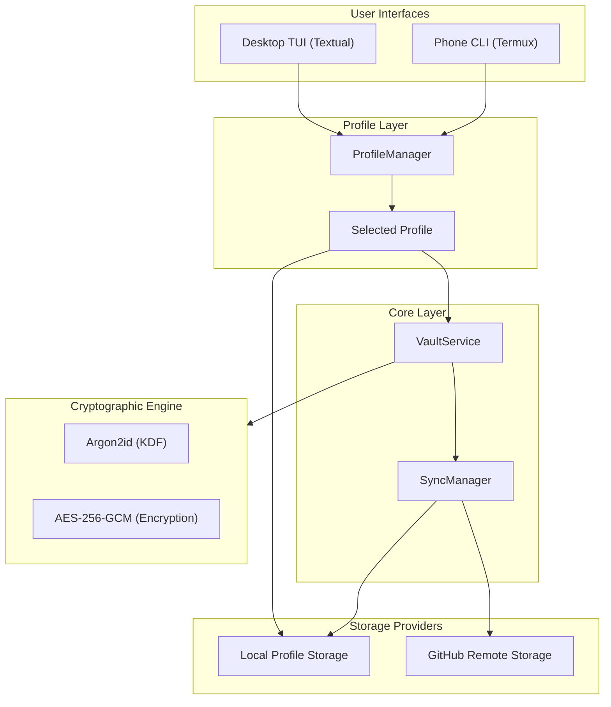

Note to myself

Some code is not being read due to a bug or my undersight. Work on it

---
# Elk Password Manager

Elk is a secure, keyboard-first, terminal-based password manager. It provides a dual-interface approach: a rich, keyboard-driven terminal user interface (TUI) for desktops, and a lightweight, zero-dependency console interface optimized for mobile devices (like Termux on Android).

With local-first storage, Argon2id key derivation, and AES-256-GCM encryption, Elk guarantees that your credentials remain private and secure while providing seamless GitHub-backed cloud synchronization.

---

## Architecture

Elk's design separates the interactive presentation layers from the core cryptographic and storage services. Here is an overview of the system architecture:

### Component Diagram (Hand-Drawn Style)


### System Workflow



---

## Features

* **Dual Interfaces**

  * **Desktop TUI**: Full-screen, responsive, keyboard-first UI with split-pane navigation built on [Textual](https://github.com/Textualize/textual).
  * **Phone CLI**: Lightweight console interface designed for mobile devices and Termux.

* **Multiple Profiles**

  * Create, rename, delete, and switch between profiles.
  * Set a default profile for automatic selection at startup.
  * Each profile has its own encrypted vault and master password.

* **Profile Isolation**

  * Each profile has its own vault and settings.
  * Switching profiles creates a new vault and settings context.
  * Master passwords and encryption keys are never stored in profile metadata.

* **Security**

  * **Key Derivation**: Argon2id KDF.
  * **Encryption**: AES-256-GCM authenticated encryption.
  * **Clipboard Timeout**: Automatic clipboard clearing after a configurable interval.

* **GitHub-Backed Sync**

  * Synchronize encrypted vaults with a private GitHub repository.
  * Profile-specific remote vault paths.
  * Dirty-state tracking to minimize unnecessary API requests.
  * Supports fine-grained GitHub Personal Access Tokens.

* **Vault Backup**

  * Import and export encrypted vault files locally.
  * Exported vaults retain their existing encryption and master password.

---

## Getting Started

### Prerequisites

Ensure you have Python 3.11 or newer installed.

### Installation

Clone the repository and install the dependencies:

```bash
# Clone the repository
git clone https://github.com/yourusername/elk.git
cd elk

# Install dependencies using uv (recommended)
uv sync

# Or using standard pip
pip install -r requirements.txt
```

### Running the Desktop TUI

To launch the desktop interface:

```bash
python src/main.py
```

On the first launch, Elk creates a default `Personal` profile and asks you to create its master password.

* **Navigation keys**:

  * `1`: View Passwords screen
  * `2`: View Emails screen
  * `3`: View Settings screen
  * `f` / `Ctrl+F`: Toggle search bar
  * `a`: Add new item
  * `e`: Edit selected item
  * `d`: Delete selected item
  * `y`: Copy selected password to clipboard
  * `p`: Reveal / hide password
  * `Ctrl+S`: Save item
  * `Esc`: Cancel editing or close search
  * `q`: Quit application

### Running the Phone Companion

To launch the lightweight phone app:

```bash
python src/phone/main.py
```

The phone interface provides a lightweight CLI for working with the same encrypted vault format.

---

## Profiles

Each profile has its own encrypted vault and settings:

```text
data/
├── profiles.json
└── profiles/
    ├── personal/
    │   ├── vault.enc
    │   └── settings.json
    │
    └── work/
        ├── vault.enc
        └── settings.json
```

Each profile has an independent master password and encryption key.

`profiles.json` stores profile metadata and the default/active profile. It does not store master passwords or encryption keys.

---

## Configuration & Sync

Each profile stores its configuration separately:

```text
data/profiles/<profile-id>/settings.json
```

This allows profiles to have independent GitHub repositories and synchronization settings.

### Setting Up GitHub Cloud Sync

To sync your vault across machines:

1. Create a **private** GitHub repository dedicated to Elk vault synchronization.
2. Generate a **Fine-grained Personal Access Token (PAT)**.
3. Grant `Contents` **Read and write** access to the repository.
4. Open Elk's **Settings → GitHub Sync**.
5. Enter the GitHub username, repository name, and token.
6. Enable synchronization.

The remote repository uses profile-specific paths:

```text
elk-vault/
└── data/
    └── profiles/
        ├── personal/
        │   └── vault.enc
        └── work/
            └── vault.enc
```

Only encrypted vault files are synchronized.

---

## Import & Export

Import and export operate on encrypted vault files.

Exporting a vault does not decrypt or change it. An imported vault retains its existing encryption and therefore requires its original master password.

For example:

```text
Encrypted vault
    ↓
Export
    ↓
Import
    ↓
Same encryption + same master password
```

---

## License

This project is licensed under the MIT License - see the LICENSE file for details.
