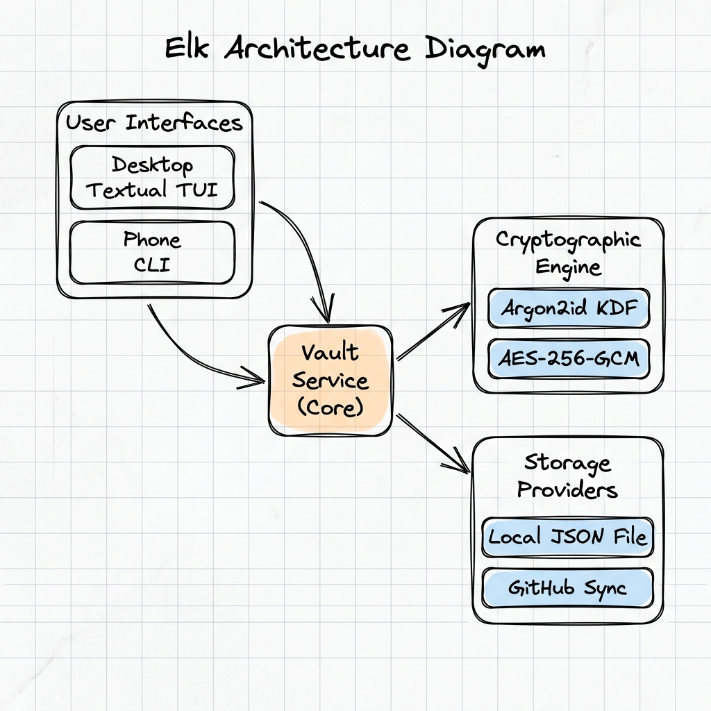
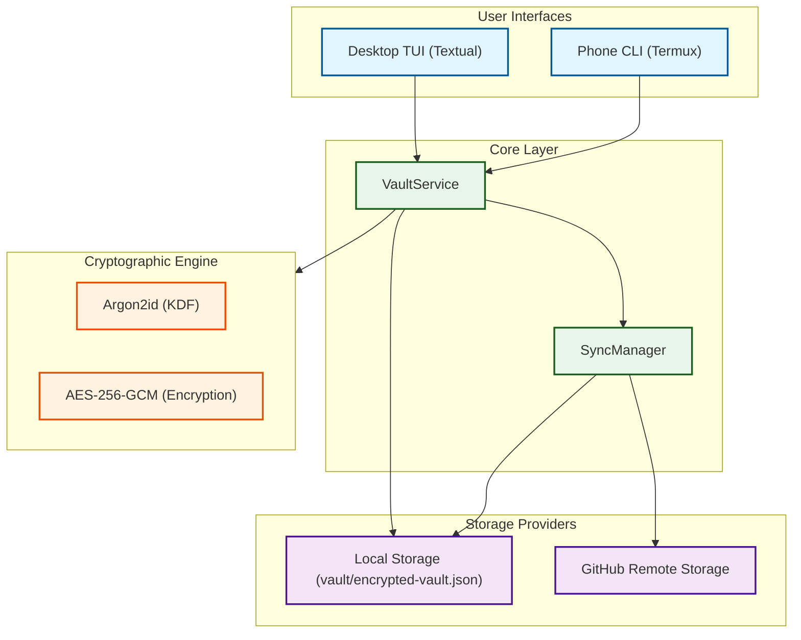

Note to myself

Some code is not being read due to a bug or my undersight. Work on it

---
# Elk Password Manager

Elk is a secure, keyboard-first, terminal-based password manager. It provides a dual-interface approach: a rich, keyboard-driven terminal user interface (TUI) for desktops, and a lightweight, zero-dependency console interface optimized for mobile devices (like Termux on Android).

With local-first storage, Argon2id key derivation, and AES-256-GCM encryption, Elk guarantees that your credentials remain private and secure while providing seamless GitHub-backed cloud synchronization.

---

## Architecture

Elk's design separates the interactive presentation layers from the core cryptographic and storage services. Here is an overview of the system architecture:

### Component Diagram (Hand-Drawn Style)


### System Workflow


---

## Features

*   **Dual Interfaces**:
    *   **Desktop TUI**: Full-screen, responsive, keyboard-first UI with split-pane navigation built on [Textual](https://github.com/Textualize/textual).
    *   **Phone CLI**: Fast, getpass-secured console client running immediately on startup with query search, optimized for mobile Termux.
*   **Military-Grade Security**:
    *   **Key Derivation**: Argon2id KDF (configurable memory/iterations) to derive strong 256-bit encryption keys.
    *   **Encryption**: AES-256-GCM for strong authenticated database encryption.
    *   **Secure Password Changes**: Re-encrypts your entire database and any saved credentials (like GitHub tokens) under a new key.
*   **GitHub-Backed Cloud Sync**:
    *   Securely pushes and pulls local changes to a private GitHub repository.
    *   Uses dirty-state tracking to minimize unnecessary API requests.
    *   Supports Fine-grained Personal Access Tokens (PAT).
*   **Safety Features**:
    *   **Auto-Lock**: Locks database after configurable minutes of inactivity.
    *   **Clipboard Timeout**: Automatic clipboard clearing after custom intervals.
    *   **Vault Backup**: Fast local import and export operations for encrypted backups.

---

## Getting Started

### Prerequisites

Ensure you have Python 3.11 or newer installed.

### Installation

Clone the repository and install the dependencies:

```bash
# Clone the repository
git clone https://github.com/yourusername/elk.git
cd elk

# Install dependencies using uv (recommended)
uv sync

# Or using standard pip
pip install -r requirements.txt
```

### Running the Desktop TUI

To launch the desktop interface:

```bash
python src/main.py
```

*   **Navigation keys**:
    *   `1`: View Passwords screen
    *   `2`: View Emails screen
    *   `3`: View Settings screen
    *   `f` / `Ctrl+F`: Toggle search bar
    *   `a`: Add new item
    *   `e`: Edit selected item
    *   `d`: Delete selected item
    *   `y`: Copy selected password to clipboard
    *   `p`: Reveal / hide password
    *   `Ctrl+S`: Save item
    *   `Esc`: Cancel editing or close search
    *   `q`: Quit application

### Running the Phone Companion

To launch the lightweight phone app:

```bash
python src/phone/main.py
```

*   **Keyboard Commands**:
    *   `[S]`: Start a new search
    *   `[A]`: Add a new entry
    *   `[Y]`: Force manual sync with GitHub
    *   `[L]`: Lock vault and return to login prompt
    *   `[X]`: Exit companion
    *   `[Number Selection]`: View entry details (includes copying password using `termux-clipboard-set`)

---

## Configuration & Sync

All configuration and data reside within the local `vault/` directory:
- `vault/encrypted-vault.json`: The encrypted JSON database containing your credentials.
- `vault/settings.json`: Settings configuration (clipboard timeouts, auto-lock timeouts, and encrypted GitHub tokens).

### Setting up GitHub Cloud Sync

To sync your vault across machines:
1. Create a **private** repository on GitHub (e.g. `my-private-vault`).
2. Generate a **Fine-grained Personal Access Token (PAT)** on GitHub:
   - Go to `Settings -> Developer settings -> Personal access tokens -> Fine-grained tokens`.
   - Grant repository permissions: `Contents` (Read and Write).
   - Scope it to only your private vault repository.
3. Open the **Elk Desktop TUI**, switch to the **Settings** screen (press `3`), and select **GitHub Sync**.
4. Complete the configuration fields (Username, Repository Name, and Personal Access Token) and save.

Your configuration token is encrypted using AES-256-GCM before saving to disk.

---

## License

This project is licensed under the MIT License - see the LICENSE file for details.
